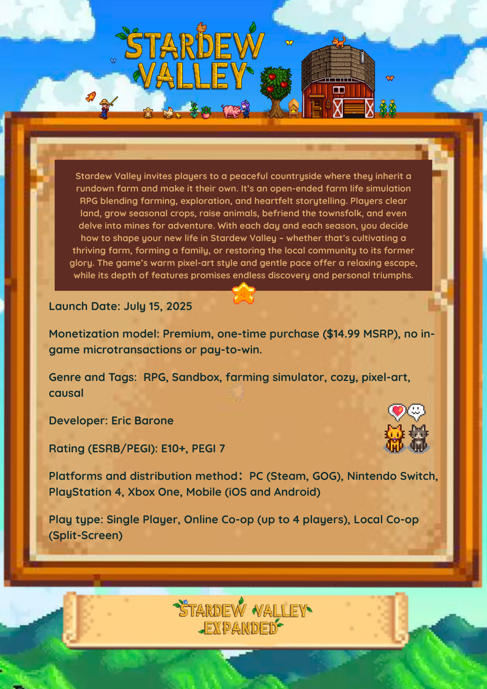
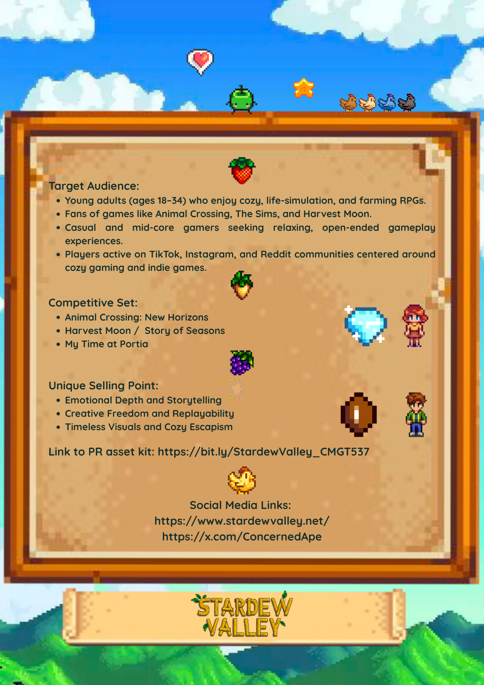

# Xinyue (Michelle) Zhang – Product, Data & AI Portfolio

Welcome! I'm a product management professional with a Master's degree in Communication Data Science from the University of Southern California (USC).

My experience spans end-to-end product management, AI-powered consumer products, gaming, user engagement, and monetization. I combine product thinking, technical understanding, and data-driven insights to translate user needs and business objectives into actionable product strategies.

This portfolio showcases my work across product development, AI applications, growth strategy, and data analytics.

---

## Featured Projects

### 🕹️ GameXmos – Web-Based Mini-Game Platform

Contributed to the product strategy and development of GameXmos, a browser-based mini-game platform designed to deliver accessible, engaging, and frictionless gaming experiences without requiring downloads.

- Identified product opportunities through market research, competitive analysis, and player experience evaluation.
- Defined product requirements and informed feature prioritization based on user needs, market fit, and business objectives.
- Developed game content recommendations and evaluated gameplay mechanics to support the platform's content strategy.
- Collaborated with developers and stakeholders to align product direction, user experience, and development execution.

**Focus:** Product Management, Product Strategy, Product Requirements, Feature Prioritization, Gaming Experience, Competitive Analysis, Cross-functional Collaboration

- 🔗 Live Product: [Explore GameXmos](https://gamexmos.com/)

---

### 🤖 AI Fit - Fitly (Digital Twin Prototype)

Built a prototype that simulates virtual try-on using structured user body data (height, weight) to improve fit recommendations and reduce return risk.

Designed prompt-based workflows to generate consistent digital body representations and explored how AI-driven visualization influences user decision-making.

**Tech:** Generative AI, Prompt Engineering, AI Workflow Design, Product Prototyping

- 🔗 Demo: [Explore AI Fit](https://v0-fitly-cyan.vercel.app/)

---

### 🌾 Stardew Valley GTM Strategy

Developed a go-to-market strategy for a simulation game, including audience segmentation, positioning, and launch planning.

Analyzed player motivations and comparable titles to define target segments and recommend a differentiated market entry strategy.

Proposed launch sequencing and growth approach based on user behavior assumptions and market positioning.

#### 📌 Product Fact Sheet

A summary of positioning, target audience, and core value proposition.

  
  

**Focus:** Market Analysis, User Segmentation, Product Strategy, GTM Strategy

- 📊 Slides: [View Slides](https://www.canva.com/design/DAGkk9sFGjc/RRPXIJRucGYv45BufAJDeg/edit?utm_content=DAGkk9sFGjc&utm_campaign=designshare&utm_medium=link2&utm_source=sharebutton)

---

### 🎮 Sentiment Analysis on Game Communities

Analyzed how pre-launch and post-launch Reddit sentiment, emotion, and discussion volume related to game launch performance (peak CCU), with genre-level comparisons across Shooting and Simulation titles.

**Tech:** Python, Sentiment Analysis, Data Visualization, Regression Analysis

- 🔗 GitHub: [View Repository](https://github.com/o1s31/game-sentiment-analysis/tree/main)
- 📊 Slides: [View Slides](https://www.canva.com/design/DAG5-dTQ1TM/0fQ0B7ZE8dKS4igqXXL40w/edit)

---

### 📊 Steam Pricing & Player Perception Dashboard

Analyzed Steam pricing and discount strategies to understand how discount depth, timing, and game age relate to player reception and perceived value.

Explored relationships between release age, rating feedback, and discount frequency to identify signals of sustained interest versus short-term promotion effects.

Built an interactive dashboard to visualize pricing strategies and their impact on engagement trends.

**Tech:** R, Shiny, Data Visualization, Exploratory Data Analysis

- 🔗 Demo: [View Dashboard](https://givenmich.shinyapps.io/info201-final-project/)

---

### 📚 Duolingo Learning Model Analysis

Explored learning behavior and recall probability using large-scale Duolingo data, applying statistical modeling and regression techniques.

**Tech:** Python, pandas, Statistical Modeling, Regression Analysis, Data Visualization

- 🔗 GitHub: [View Repository](https://github.com/o1s31/duolingo-learning-model)

---

## Skills

### Product Management
- Product Strategy & Roadmap Planning
- Product Requirements Documentation (PRD)
- Feature Prioritization & Scope Management
- Product Lifecycle Management
- Cross-functional Collaboration
- Product Metrics & Performance Evaluation

### Market & Growth Strategy
- Competitive Analysis & Market Research
- User Research & Segmentation
- Go-to-Market Strategy
- User Engagement & Retention
- Monetization Strategy

### AI & Product Applications
- Generative AI Workflow Design
- Prompt Engineering
- AI Product Prototyping
- Data-driven Decision Making

### Data Analysis & Experimentation
- Exploratory Data Analysis (EDA)
- Statistical Reasoning
- A/B Testing & Experiment Design
- User Behavior & Retention Analysis

### Programming
- Python (pandas, NumPy)
- SQL
- R

### Machine Learning & Modeling
- Predictive Modeling
- Regression Analysis
- Cross-Validation
- Model Evaluation & Tuning

### NLP & Text Analysis
- Sentiment Analysis (Reddit & User-generated Content)
- Text Processing & Cleaning

### Data Visualization
- matplotlib, seaborn
- Interactive Dashboard Development
- Insight Communication & Storytelling

---

## Contact

- LinkedIn: [Connect on LinkedIn](https://www.linkedin.com/in/michelle-zhang-623bb2200/)
- GitHub: [View GitHub Profile](https://github.com/o1s31)
- Email: [o1sgivenmich@gmail.com](mailto:o1sgivenmich@gmail.com)
